# Diagrama entitate-relație (ER) — SportBuddy

Tabelele din baza de date PostgreSQL, așa cum le creează Hibernate din entitățile Java (`ddl-auto=update`). Diagrama este făcută după codul din `backend/src/main/java/ro/utcn/sportbuddy/*/model/`, deci arată schema reală, nu doar cea planificată în `entitati.md`.

## Cum se citește

- Fiecare dreptunghi este un tabel; în el sunt coloanele, cu tipul Java și cheile: `PK` (cheie primară), `FK` (trimitere la alt tabel), `UK` (valoare unică).
- **Linie plină**: legătură între două tabele din **același modul** (de exemplu `posts` și `comments`, ambele din `feed`).
- **Linie punctată**: legătură între **module diferite** (de exemplu `posts.authorId` către `users`). Conform regulii 3 din brief, aceste legături se fac doar prin id, fără relații JPA (`@ManyToOne`); datele celuilalt modul se cer prin service-ul lui.
- Cardinalitatea: `||` exact unul, `o|` zero sau unul, `o{` zero sau mai mulți, `|{` unul sau mai mulți.

În cod nu există niciun `@ManyToOne` sau `@OneToMany`: și legăturile din același modul se fac prin id. Liniile pline arată doar că tabelele aparțin aceluiași modul și se pot citi împreună în același service.

## Diagrama

```mermaid
erDiagram
    %% ---------- users (A) ----------
    USERS {
        Long id PK
        String username UK
        String fullName
        String email UK
        String passwordHash "BCrypt; null la Google și iCloud"
        AuthProvider authProvider "LOCAL, GOOGLE, ICLOUD"
        Integer age "16-99"
        String phone
        String photoPath "fișier în uploads/"
        String bio "max 300"
        Long cityId FK
        boolean active "false după ștergerea contului"
        Instant createdAt
    }
    USER_SETTINGS {
        Long userId PK, FK
        Theme theme "SYSTEM, LIGHT, DARK"
        boolean showWeather
        boolean notifJoinRequests
        boolean notifMessages
        boolean notifReminders
        boolean notifEmailDigest
        ProfileVisibility profileVisibility "EVERYONE, FRIENDS"
        WhoCanAddMe whoCanAddMe "EVERYONE, FRIENDS_OF_FRIENDS, NOBODY"
        boolean showFriendList
    }
    USER_SPORTS {
        Long id PK
        Long userId FK "UK împreună cu sportId"
        Long sportId FK
        SportLevel declaredLevel "BEGINNER, INTERMEDIATE, ADVANCED"
    }

    %% ---------- feed (A) ----------
    POSTS {
        Long id PK
        Long authorId FK
        Long sportId FK
        PostTag tag "TOURNAMENT, DISCUSSION, LOOKING_FOR_PLAYERS"
        String text "max 1000"
        Instant createdAt
    }
    COMMENTS {
        Long id PK
        Long postId FK
        Long authorId FK
        String text "max 500"
        Instant createdAt
    }
    POST_LIKES {
        Long id PK
        Long postId FK "UK împreună cu userId"
        Long userId FK
    }

    %% ---------- friends (A) ----------
    FRIENDSHIPS {
        Long id PK
        Long requesterId FK "UK împreună cu addresseeId"
        Long addresseeId FK
        FriendshipStatus status "PENDING, ACCEPTED, DECLINED"
        Instant createdAt
        Instant respondedAt
    }
    DIRECT_MESSAGES {
        Long id PK
        Long senderId FK
        Long recipientId FK
        String text "max 1000"
        Instant sentAt
        Instant readAt "null până la citire"
    }

    %% ---------- catalog (B) ----------
    CITIES {
        Long id PK
        String name UK
        Double latitude
        Double longitude
    }
    SPORTS {
        Long id PK
        String code UK "football, tennis..."
        String name UK
        Integer defaultCapacity
        String venueLabel
        boolean indoor
    }
    FIELDS {
        Long id PK
        Long cityId FK
        Long sportId FK
        String name
        String district
    }

    %% ---------- lobbies (B) ----------
    LOBBIES {
        Long id PK
        Long creatorId FK "organizatorul"
        Long sportId FK
        Long cityId FK
        Long fieldId FK
        LocalDateTime startAt
        Integer capacity
        Integer minPlayers
        BigDecimal fieldCost "RON"
        Integer guestCount "jucători fără cont aduși de organizator"
        LobbyStatus status "OPEN, LOCKED, FINISHED, CANCELLED"
        LocalDateTime lockDeadline
        LocalDateTime lockedAt
        BigDecimal finalPricePerPlayer
        boolean attendanceSaved
        Instant createdAt
    }
    LOBBY_PLAYERS {
        Long id PK
        Long lobbyId FK "UK împreună cu userId"
        Long userId FK
        PlayerStatus status "JOINED, CANCELLED_FREE, CANCELLED_LATE, NO_SHOW, ATTENDED"
        PaymentMethod paymentMethod "ON_SITE, ONLINE"
        boolean paid
        Instant joinedAt
        Instant cancelledAt
    }
    JOIN_REQUESTS {
        Long id PK
        Long lobbyId FK
        Long userId FK
        JoinRequestStatus status "PENDING, ACCEPTED, REJECTED, WITHDRAWN"
        Instant createdAt
        Instant decidedAt
    }

    %% ---------- payments (B) ----------
    PAYMENTS {
        Long id PK
        Long lobbyId FK
        Long userId FK
        BigDecimal amount
        String currency "RON"
        PaymentStatus status "PENDING, PAID, FAILED, REFUNDED"
        String provider "MOCK"
        String providerRef
        Instant createdAt
    }

    %% ---------- ratings (C) ----------
    REVIEWS {
        Long id PK
        Long lobbyId FK
        Long reviewerId FK "null la review-urile automate"
        Long targetUserId FK
        ReviewType type "NORMAL, LATE_CANCEL, NO_SHOW"
        Integer stars "1-5"
        String comment
        Instant createdAt
    }
    USER_RATING_STATS {
        Long userId PK, FK
        Integer reviewCount
        Double avgRating
        Integer attendedCount
        Integer lateCancelCount
        Integer noShowCount
        Instant updatedAt
    }

    %% ---------- chat (C) ----------
    LOBBY_MESSAGES {
        Long id PK
        Long lobbyId FK
        Long senderId FK "null la mesajele de sistem"
        boolean system
        String text "max 500"
        Instant sentAt
    }

    %% legături în același modul (linie plină)
    USERS ||--|| USER_SETTINGS : "are setările"
    USERS ||--o{ USER_SPORTS : "joacă"
    POSTS ||--o{ COMMENTS : "are"
    POSTS ||--o{ POST_LIKES : "primește"
    CITIES ||--o{ FIELDS : "conține"
    SPORTS ||--o{ FIELDS : "se joacă pe"
    LOBBIES ||--|{ LOBBY_PLAYERS : "are participanți"
    LOBBIES ||--o{ JOIN_REQUESTS : "primește cereri"

    %% legături între module, doar prin id (linie punctată)
    SPORTS ||..o{ USER_SPORTS : "sportul ales"
    CITIES |o..o{ USERS : "orașul implicit"
    USERS ||..o{ POSTS : "scrie"
    SPORTS ||..o{ POSTS : "despre"
    USERS ||..o{ COMMENTS : "scrie"
    USERS ||..o{ POST_LIKES : "dă like"
    USERS ||..o{ FRIENDSHIPS : "trimite cererea"
    USERS ||..o{ FRIENDSHIPS : "primește cererea"
    USERS ||..o{ DIRECT_MESSAGES : "trimite"
    USERS ||..o{ DIRECT_MESSAGES : "primește"
    USERS ||..o{ LOBBIES : "organizează"
    FIELDS ||..o{ LOBBIES : "găzduiește"
    USERS ||..o{ LOBBY_PLAYERS : "participă"
    USERS ||..o{ JOIN_REQUESTS : "cere să intre"
    LOBBIES ||..o{ PAYMENTS : "încasează"
    USERS ||..o{ PAYMENTS : "plătește"
    LOBBIES ||..o{ REVIEWS : "generează"
    USERS ||..o{ REVIEWS : "este evaluat"
    USERS |o..o{ REVIEWS : "evaluează"
    USERS ||..o| USER_RATING_STATS : "are statisticile"
    LOBBIES ||..o{ LOBBY_MESSAGES : "are chat"
    USERS |o..o{ LOBBY_MESSAGES : "scrie"
```

## Module și tabele

| Modul | Responsabil | Tabele |
|---|---|---|
| `users` | A | `users`, `user_settings`, `user_sports` |
| `feed` | A | `posts`, `comments`, `post_likes` |
| `friends` | A | `friendships`, `direct_messages` |
| `catalog` | B | `cities`, `sports`, `fields` |
| `lobbies` | B | `lobbies`, `lobby_players`, `join_requests` |
| `payments` | B | `payments` |
| `ratings` | C | `reviews`, `user_rating_stats` |
| `chat` | C | `lobby_messages`, `lobby_chat_reads` |
| `auth`, `weather`, `dashboard` | A, C | fără tabele proprii (`auth` folosește `users`; vremea se ține în memorie; `dashboard` doar citește din alte module) |

## Observații

- **Legături prin id.** Un modul nu citește tabelele altui modul: `feed` află numele autorului prin `UserService.findRefs`, `lobbies` află terenul prin `CatalogService.findField`. Așa modulele rămân independente și pot fi explicate și testate separat.
- **Chei unice compuse** (o singură pereche permisă): `user_sports` (utilizator, sport), `post_likes` (postare, utilizator), `friendships` (expeditor, destinatar), `lobby_players` (lobby, utilizator), `reviews` (lobby, evaluator, evaluat).
- **Relații 1–1** prin aceeași cheie primară: `user_settings.userId` și `user_rating_stats.userId` sunt chiar id-ul utilizatorului.
- **Date copiate pentru filtrare.** `lobbies.sportId` și `lobbies.cityId` se pot afla din teren (`fields`), dar sunt păstrate și în lobby, ca listarea pe oraș, sport și zi să fie o singură interogare.
- **Conturi șterse.** Un utilizator care își șterge contul nu dispare din `users` (`active = false`, date anonimizate), ca lobby-urile, review-urile și mesajele vechi să rămână valide.
- **Enum-uri** salvate ca text (`@Enumerated(EnumType.STRING)`); valorile posibile sunt scrise lângă fiecare coloană.
- **Diferență față de `entitati.md`:** `sports` are în cod și coloana `code` (de exemplu `football`), folosită de frontend pentru iconițe și culori; în `entitati.md` nu apare.
