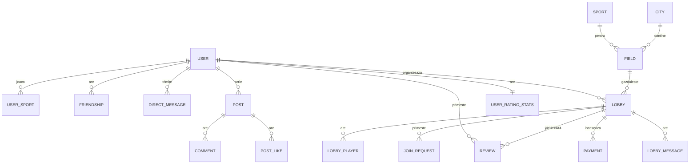

# Entități (tabele) — SportBuddy

Document de referință pentru toți trei. Orice modificare (câmp nou, tip schimbat) trece prin Pull Request aprobat de cei trei, pentru că schimbă schema bazei de date.

## Convenții

- Fiecare entitate are `id` de tip `Long`, generat automat (`GenerationType.IDENTITY`).
- Enum-urile se salvează ca text: `@Enumerated(EnumType.STRING)`.
- Tabelele se numesc în snake_case, la plural (`lobby_players`).
- Data și ora meciului: `LocalDateTime` (ora României, fără fus orar). Momentele din sistem (`createdAt`, `sentAt`): `Instant`.
- Bani: `BigDecimal`, în RON.
- **Legăturile dintre module se fac doar prin id** (de exemplu `userId`, `cityId`), fără `@ManyToOne` către entitățile altui modul. Detaliile altui modul se cer prin service-ul lui. Relațiile JPA (`@ManyToOne`, `@OneToMany`) se folosesc doar în interiorul aceluiași modul.
- Schema se creează automat (`ddl-auto=update`). Dacă schimbi o entitate serios, anunți grupul, iar toți resetează baza (`DROP DATABASE sportbuddy; CREATE DATABASE sportbuddy;`).

## Harta relațiilor

## Cine deține ce

| Modul | Proprietar | Entități |
|---|---|---|
| `users`, `auth` | A | `User`, `UserSettings`, `UserSport` |
| `friends` | A | `Friendship`, `DirectMessage` |
| `feed` | A | `Post`, `Comment`, `PostLike` |
| `catalog` | B | `City`, `Sport`, `Field` |
| `lobbies` | B | `Lobby`, `LobbyPlayer`, `JoinRequest` |
| `payments` | B | `Payment` |
| `ratings` | C | `Review`, `UserRatingStats` |
| `chat` | C | `LobbyMessage` |
| `weather`, `dashboard` | C | nu au tabele (vremea se ține în memorie, `dashboard` doar citește din alte module) |

---

## Persoana A

### `User` (`users`)

| Câmp | Tip | Reguli |
|---|---|---|
| id | Long | PK |
| username | String | unic; la înregistrare se generează din nume sau email |
| fullName | String | **obligatoriu** |
| email | String | **obligatoriu**, unic |
| passwordHash | String | BCrypt; `null` pentru conturi create cu Google/iCloud |
| authProvider | enum | `LOCAL`, `GOOGLE`, `ICLOUD` |
| age | Integer | **obligatoriu la cont nou**, între 16 și 99 |
| phone | String | opțional |
| photoPath | String | opțional; poza se salvează în folderul `uploads/` (în `.gitignore`) |
| bio | String | opțional, maxim 300 de caractere |
| cityId | Long | orașul implicit (din `City`, modulul B) |
| active | boolean | implicit `true`; devine `false` când utilizatorul își șterge contul (datele personale se anonimizează, rândul rămâne pentru istoric) |
| createdAt | Instant | |

Obligatorii la înregistrare: `fullName`, `email`, parolă (pentru `LOCAL`), `age` și cel puțin un sport în `UserSport`. Restul se poate completa ulterior din setări.

### `UserSettings` (`user_settings`)

| Câmp | Tip | Reguli |
|---|---|---|
| userId | Long | PK și FK către `User` (relație 1–1) |
| theme | enum | `SYSTEM`, `LIGHT`, `DARK` |
| showWeather | boolean | implicit `true` |
| notifJoinRequests | boolean | implicit `true` |
| notifMessages | boolean | implicit `true` |
| notifReminders | boolean | implicit `true` |
| notifEmailDigest | boolean | implicit `false` |
| profileVisibility | enum | `EVERYONE`, `FRIENDS` |
| whoCanAddMe | enum | `EVERYONE`, `FRIENDS_OF_FRIENDS`, `NOBODY` |
| showFriendList | boolean | implicit `true` |

Ratingul nu se poate ascunde, pentru că trebuie să fie vizibil înainte ca cineva să se alăture unui lobby.

### `UserSport` (`user_sports`)

| Câmp | Tip | Reguli |
|---|---|---|
| id | Long | PK |
| userId | Long | FK `User` |
| sportId | Long | din `Sport` (modulul B) |
| declaredLevel | enum | `BEGINNER`, `INTERMEDIATE`, `ADVANCED`; se afișează până apar review-uri |

Unic pe perechea (`userId`, `sportId`).

### `Friendship` (`friendships`)

| Câmp | Tip | Reguli |
|---|---|---|
| id | Long | PK |
| requesterId | Long | cine trimite cererea |
| addresseeId | Long | cine o primește |
| status | enum | `PENDING`, `ACCEPTED`, `DECLINED` |
| createdAt, respondedAt | Instant | |

Unic pe perechea (`requesterId`, `addresseeId`). Cererea respectă `UserSettings.whoCanAddMe`.

### `DirectMessage` (`direct_messages`)

| Câmp | Tip | Reguli |
|---|---|---|
| id | Long | PK |
| senderId, recipientId | Long | mesaje doar între prieteni (`ACCEPTED`) |
| text | String | maxim 1000 de caractere |
| sentAt | Instant | |
| readAt | Instant | `null` până e citit |

### `Post` (`posts`)

| Câmp | Tip | Reguli |
|---|---|---|
| id | Long | PK |
| authorId | Long | |
| sportId | Long | din `Sport`; permite filtrarea pe sport |
| tag | enum | `TOURNAMENT`, `DISCUSSION`, `LOOKING_FOR_PLAYERS` |
| text | String | maxim 1000 de caractere |
| createdAt | Instant | |

### `Comment` (`comments`)

| Câmp | Tip | Reguli |
|---|---|---|
| id | Long | PK |
| postId | Long | FK `Post` (același modul, `@ManyToOne` permis) |
| authorId | Long | |
| text | String | |
| createdAt | Instant | |

### `PostLike` (`post_likes`)

| Câmp | Tip | Reguli |
|---|---|---|
| id | Long | PK |
| postId | Long | FK `Post` |
| userId | Long | |

Unic pe perechea (`postId`, `userId`). Apăsarea repetată pe like îl șterge.

---

## Persoana B

### `City` (`cities`)

| Câmp | Tip | Reguli |
|---|---|---|
| id | Long | PK |
| name | String | unic, de exemplu `Baia Mare` |
| latitude, longitude | Double | folosite de modulul `weather` (C) |

Se populează din seeder cu peste 100 de orașe din România.

### `Sport` (`sports`)

| Câmp | Tip | Reguli |
|---|---|---|
| id | Long | PK |
| code | String | unic, în engleză, fără diacritice: `football`, `basketball`, `tennis`, `padel`, `volleyball`, `handball`, `badminton`, `table-tennis`, `squash`, `running`, `cycling`, `swimming` (folosit de frontend pentru culori și iconițe) |
| name | String | unic: Fotbal, Baschet, Tenis, Padel, Volei, Handbal, Badminton, Tenis de masă, Squash, Alergare, Ciclism, Înot |
| defaultCapacity | Integer | de exemplu 10 pentru fotbal |
| venueLabel | String | de exemplu „Teren de fotbal", „Sală de baschet" |
| indoor | boolean | folosit de `weather` pentru recomandarea „mai bine în sală" |

### `Field` (`fields`)

| Câmp | Tip | Reguli |
|---|---|---|
| id | Long | PK |
| cityId | Long | FK `City` (același modul) |
| sportId | Long | FK `Sport` |
| name | String | de exemplu „Teren de fotbal – Centru" |
| district | String | zona din oraș |

### `Lobby` (`lobbies`)

| Câmp | Tip | Reguli |
|---|---|---|
| id | Long | PK |
| creatorId | Long | organizatorul (un `User`) |
| sportId, cityId | Long | |
| fieldId | Long | FK `Field` |
| startAt | LocalDateTime | data și ora meciului; cel puțin 3 ore în viitor, minutele multiplu de 15 |
| capacity | Integer | numărul total de locuri, minim 2 |
| minPlayers | Integer | minim 2, maxim `capacity` |
| fieldCost | BigDecimal | costul terenului în RON; 0 = gratuit |
| guestCount | Integer | câți jucători aduce organizatorul fără cont (inclusiv el nu se numără aici, el e în `LobbyPlayer`) |
| status | enum | `OPEN`, `LOCKED`, `FINISHED`, `CANCELLED` |
| lockDeadline | LocalDateTime | termenul de confirmare, calculat la creare |
| lockedAt | LocalDateTime | când s-a confirmat |
| finalPricePerPlayer | BigDecimal | `null` până la confirmare |
| attendanceSaved | boolean | `true` după ce organizatorul bifează prezența |
| createdAt | Instant | |

Locuri ocupate = `guestCount` + numărul de `LobbyPlayer` cu status `JOINED`. Locuri libere = `capacity` − locuri ocupate.

### `LobbyPlayer` (`lobby_players`)

| Câmp | Tip | Reguli |
|---|---|---|
| id | Long | PK |
| lobbyId | Long | FK `Lobby` |
| userId | Long | organizatorul este și el un `LobbyPlayer` |
| status | enum | `JOINED`, `CANCELLED_FREE`, `CANCELLED_LATE`, `NO_SHOW`, `ATTENDED` |
| paymentMethod | enum | `ON_SITE` (implicit), `ONLINE` |
| paid | boolean | `true` doar pentru plata online reușită |
| joinedAt, cancelledAt | Instant | |

Unic pe perechea (`lobbyId`, `userId`).

### `JoinRequest` (`join_requests`)

| Câmp | Tip | Reguli |
|---|---|---|
| id | Long | PK |
| lobbyId, userId | Long | |
| status | enum | `PENDING`, `ACCEPTED`, `REJECTED`, `WITHDRAWN` |
| createdAt, decidedAt | Instant | |

Un utilizator nu poate avea două cereri `PENDING` pentru același lobby. Cererea se acceptă doar dacă lobby-ul e `OPEN` și are locuri libere.

### `Payment` (`payments`)

| Câmp | Tip | Reguli |
|---|---|---|
| id | Long | PK |
| lobbyId, userId | Long | |
| amount | BigDecimal | egal cu `finalPricePerPlayer` |
| currency | String | `RON` |
| status | enum | `PENDING`, `PAID`, `FAILED`, `REFUNDED` |
| provider | String | `MOCK` (interfața `PaymentProvider` permite alt provider mai târziu) |
| providerRef | String | număr generat de mock |
| createdAt | Instant | |

---

## Persoana C

### `Review` (`reviews`)

| Câmp | Tip | Reguli |
|---|---|---|
| id | Long | PK |
| lobbyId | Long | |
| reviewerId | Long | `null` pentru review-urile generate de sistem |
| targetUserId | Long | cel evaluat |
| type | enum | `NORMAL`, `LATE_CANCEL`, `NO_SHOW` |
| stars | Integer | 1–5; `LATE_CANCEL` = 2, `NO_SHOW` = 1 |
| comment | String | opțional |
| createdAt | Instant | |

Pentru `NORMAL`, unic pe (`lobbyId`, `reviewerId`, `targetUserId`). Review-urile se dau doar după ce lobby-ul e `FINISHED`, doar între participanți și doar către cei care au venit (nu către jucătorii aduși de organizator, care nu au cont).

### `UserRatingStats` (`user_rating_stats`)

Tabel de cache, recalculat la fiecare review nou, ca citirea ratingului să fie rapidă.

| Câmp | Tip | Reguli |
|---|---|---|
| userId | Long | PK |
| reviewCount | Integer | numărul de review-uri (toate tipurile) |
| avgRating | Double | media stelelor; `null` dacă `reviewCount` = 0 |
| attendedCount | Integer | meciuri la care a venit |
| lateCancelCount | Integer | |
| noShowCount | Integer | |
| updatedAt | Instant | |

### `LobbyMessage` (`lobby_messages`)

| Câmp | Tip | Reguli |
|---|---|---|
| id | Long | PK |
| lobbyId | Long | |
| senderId | Long | `null` pentru mesaje de sistem |
| system | boolean | `true` pentru „X s-a înscris", „Lobby confirmat" etc. |
| text | String | maxim 500 de caractere |
| sentAt | Instant | |

Doar membrii lobby-ului (status `JOINED` sau organizatorul) pot citi și scrie.

---

## Reguli de business (de implementat în `service/`)

### Termenul de confirmare (`lockDeadline`), calculat la crearea lobby-ului

| Cât timp mai e până la meci | Termenul de confirmare |
|---|---|
| 3 zile sau mai mult | cu 12 ore înainte de `startAt` |
| între 1 și 3 zile | cu 6 ore înainte |
| mai puțin de o zi | cu 2 ore înainte |

La termen, un job `@Scheduled` (rulează la fiecare minut) confirmă lobby-ul dacă are minimul de jucători. Dacă nu, organizatorul primește un mesaj de sistem și poate anula fără penalizare. Organizatorul poate confirma și manual, oricând.

### Prețul

- Cât timp lobby-ul e `OPEN`: preț estimat = `ceil(fieldCost / locuri ocupate)`. Se afișează și prețul cu lobby-ul plin: `ceil(fieldCost / capacity)`.
- La confirmare: `finalPricePerPlayer = ceil(fieldCost / locuri ocupate)`. Prețul nu se mai schimbă.
- După confirmare nu mai intră jucători noi.
- Plata se face la fața locului. Plata online (mock) e posibilă doar după confirmare.

### Anulări

| Situație | Rezultat |
|---|---|
| Jucătorul iese cât lobby-ul e `OPEN` | `CANCELLED_FREE`, fără penalizare |
| Jucătorul iese după confirmare | `CANCELLED_LATE`, review automat de 2 stele |
| Jucătorul e bifat absent după meci | `NO_SHOW`, review automat de 1 stea |
| Organizatorul anulează după confirmare | review automat de 2 stele pentru el |
| Organizatorul anulează cât e `OPEN` | fără penalizare |

### Rating și fiabilitate

- Penalizarea este un review în plus în medie: `avgNou = (avg * n + v) / (n + 1)`, unde `n` este numărul de review-uri și `v` valoarea (2 sau 1). Dacă `n` = 0, media devine direct `v`.
- Fiabilitate (procent): `attended / (attended + 0.5 * lateCancel + noShow)`. Pentru cineva fără istoric se afișează „nou".
- Ratingul și fiabilitatea sunt vizibile pe lista de participanți, înainte de alăturare.

### Evenimente între module (pachetul `common/events`)

Publicate de B (`lobbies`), ascultate de C (`ratings`, `chat`). B nu importă nimic din modulele lui C.

| Eveniment | Câmpuri | Ce face C |
|---|---|---|
| `LobbyLockedEvent` | `lobbyId`, `playerIds`, `pricePerPlayer` | mesaj de sistem în chat |
| `PlayerCancelledEvent` | `lobbyId`, `userId`, `late` | dacă `late`, creează review `LATE_CANCEL` și actualizează statisticile |
| `AttendanceSavedEvent` | `lobbyId`, `attendedIds`, `noShowIds` | `attendedCount++` pentru cei prezenți, review `NO_SHOW` pentru absenți |
| `LobbyCancelledEvent` | `lobbyId`, `byHostLate` | dacă `byHostLate`, review `LATE_CANCEL` pentru organizator; mesaj de sistem |

## Date de test (seeder, doar pe profilul `dev`, doar dacă tabela e goală)

- `City`: peste 100 de orașe cu coordonate (B, primul seeder, pentru că C are nevoie de el).
- `Sport`: cele 12 sporturi.
- `Field`: câte 3 terenuri pe oraș și sport.
- `User`: cel puțin 12 utilizatori demo (Ana, Andrei, Ioana, Vlad, Radu, Elena...), cu parola `demo123`, cu rating inițial diferit (prin review-uri de test).
- `Lobby`: lobby-uri în următoarele zile, pe mai multe sporturi, în Baia Mare și în alte orașe, plus unul deja încheiat.
- `Post`: câteva postări pe sporturi diferite.
